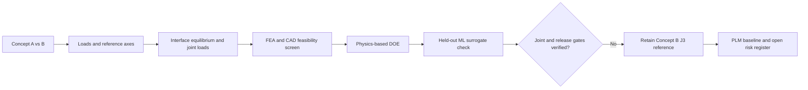

# DEP-MOUNT 2026
### Preliminary design, joint load-path analysis and ML-assisted screening of an aircraft electric-motor mount

**Status:** Independent preliminary engineering study, frozen for portfolio presentation · **Hardware release: HOLD**  
**Software:** SolidWorks · Python/Google Colab · preliminary FEA · TurboPLM  
**Reference configuration:** Concept B J3, Rev A (In Work) · **Study snapshot:** 13 November 2026

> **Provenance:** This independent portfolio work is informed by publicly available NASA X-57 motor reference material; it is not an official NASA project, NASA-supplied design, experimentally validated mount, flight-qualified article or manufacturing release. The actual CAD configuration is an unequal-flange, tapered-cradle assembly. Only the author's own SolidWorks screenshots should be used as CAD figures—**no generic CAD visualizations represent the design**.

## Executive summary

How should a lightweight distributed electric propulsion (DEP) motor mount transmit thrust, side loads, applied propeller moments, inertial reactions and installation loads while maintaining a defensible, manufacturable structural load path?

This investigation compares a four-rod support concept against a tapered cradle, chooses **Concept B J3** for detailed study, then evaluates analytical bolt/dowel reactions under published load scenarios, structural idealizations, geometry/rigidity constraints, fastener feasibility and ML surrogate screening. The study finishes with a **seven-line TurboPLM eBOM**, requirement-to-part links, a concept gate record and an open engineering change request.

The engineering decision is **to retain the existing reference CAD geometry**, not adopt an unverified minimum-mass surrogate proposal. Some substantial SolidWorks fastener interference results remain open, so the design is **not approved for physical service or flight**.

## Key results and evidence boundaries

| Workstream | Recorded evidence | Interpretation |
|---|---|---|
| Concept screening | Concept A four-rod mass ≈916 g; initial Concept B ≈820 g | Stage-dependent model estimates; not a certified assembly-level mass saving |
| Structural FEA screening | Preliminary Concept B VM ≈1.7–1.98 MPa; displacement ≈0.004 mm | Idealized boundary/load assumptions; not a qualified contact or fatigue model |
| Analytical DOE | **800** configurations; **179** conditionally passed | Proxy and geometry gates, not physical acceptance |
| ML surrogate | **25,000** additional screened candidates; threshold false-pass errors were observed | Prediction of analytical models, not experimental measurement |
| Isolated load-source study | NASA 2024 Table 9: 50 signed cases × 11 positions × two interfaces = **1,100** analytical evaluations | A distinct load basis, **not added** to 2019 cases |
| Source-correlated combined loading | NASA 2019 Figure 13: **10** correlated cases across **180** interface/position combinations | Source-based screening with project-assumed installation positions |
| Correlated peak idealized positive bolt reaction | **569.17 N** airframe; **548.17 N** motor | Reactions, not verified preload, thread or separation margins |
| Correlated nominal maximum individual dowel force | **311.21 N** motor; **271.22 N** airframe | Rigid-group assumed sharing, not verified fitted-pin load |
| Preliminary bolt proof reference | Illustrative class 8.8 proof fraction ≈**38%** | Conditional scenario, **not** a bolt-joint qualification |
| Product lifecycle | Rev A seven-line engineering BOM; requirements; ECR-10002; R00 study baseline | Concept gate passed; design and hardware release remain open |

## Engineering workflow

### CAD: the actual model

The author's **real SolidWorks screenshots (13 November 2026)** show the tapered cradle joining two different-diameter circular flanges, each with four proposed M6 fastener positions and two Ø4 dowel locations. The revised screenshot set includes a side view, end view and two isometrics. **The local SolidWorks Pack-and-Go ZIP has been saved by the author but is not yet deposited here.**

**CAD images awaiting original-file transfer to this repository** (do not substitute synthetic or unrelated geometry):

- `assets/cad/j3_side_actual_2026-11-13.png`
- `assets/cad/j3_end_actual_2026-11-13.png`
- `assets/cad/j3_isometric_front_actual_2026-11-13.png`
- `assets/cad/j3_isometric_rear_actual_2026-11-13.png`

**Known CAD limitations:** nonzero interference detections including reported screw/adapter overlaps around **206.95 mm³**, other ~48.68 / ~20 mm³ groups and minor screw/washer overlaps; pin fit, blind-hole depth, actual installation access, bolt grip/engagement, clamp and fatigue are not signed off. Correct mate constraints alone do not demonstrate physical joint feasibility.

### Analytical screening and design decision

Ten correlated NASA 2019 motor load scenarios were screened without randomly recombining independently signed extrema. A separate NASA 2024 Table 9 dataset was also studied, but the separate sources were **not summed** into a synthetic worst case. Under the assumed mounting geometry, Case 4 governed idealized airframe bolt tension, while Case 2 governed nominal motor dowel force.

The DOE and ML work evaluated mass, rigidity, bolt edge distance, thread coverage, clamp-depth and other analytical gates. Even strong overall regression scores did not establish safe classifications near critical thresholds. Therefore, **the 412.75 g conditional DOE candidate is not a built, fully verified, or selected replacement**.

### PLM configuration

TurboPLM project `DEP-2026`, parent assembly `DEP-ASM-1000`, **Rev A — In Work**:

| ID | Item | Qty |
|---|---|---:|
| DEP-PRT-1100 | Concept B J3 tapered cradle | 1 |
| DEP-PRT-1200 | J3 motor adapter | 1 |
| DEP-PRT-1300 | J3 airframe mating interface | 1 |
| DEP-HDW-2100 | M6 ISO 4017 class 8.8 bolt — final length TBD (M6×30 trial) | 8 |
| DEP-HDW-2200 | M6 ISO 7089 200 HV plain washer | 16 |
| DEP-HDW-2300 | M6 ISO 7042 locking nut, class 8 | 8 |
| DEP-HDW-2400 | Ø4×14 mm ISO 8734 dowel pin | 4 |

**REQ-10007** covers motor/airframe load transfer; **REQ-10008** covers bolted joint integrity. Both remain draft engineering requirements. **ECR-10002** remains open for fastening/joint verification. The **Concept Gate passed on 13 November 2026**; Design is In Progress; Validation, Pilot and Production have not passed. No production release is claimed.

## Technical documentation

- [Engineering problem, scope and requirements](docs/01_problem_and_requirements.md)
- [Load-path calculations and numerical results](docs/02_load_cases_and_joint_demands.md)
- [DOE and ML screening](docs/03_doe_ml.md)
- [CAD, fasteners and assembly limitations](docs/04_cad_review.md)
- [PLM baseline, traceability and change control](docs/05_plm.md)
- [Open risks and release decision](docs/06_open_risks.md)
- [Evidence provenance and reproduction boundaries](docs/07_reproducibility.md)

## Reproduction boundaries

The original Python/Colab notebooks, their embedded plots, DOE source CSV and locally saved SolidWorks Pack-and-Go archive are retained separately until uploaded to this repository. **No claim of complete end-to-end reproducibility is made until source dependencies are available.** Figures must retain their original case/assumption labels and cannot be promoted from scenario proxies to verified component strength.

## External references

- NASA NTRS, *Development of a Maxwell X-57 High Lift Motor Reference Design* (2019): https://ntrs.nasa.gov/citations/20190029267
- NASA-STD-5020B threaded-fastener guidance (informative only; not an aircraft certification standard): https://standards.nasa.gov/node/254

## Final disposition

**Preliminary engineering study: closed for portfolio presentation.**  
**Physical hardware / aircraft installation / manufacturing release: HOLD.**  

No real-aircraft installation loads, physical joint retention, thread engagement, fit-dependent dowel sharing, fatigue endurance or flightworthiness have been demonstrated. Appropriate engineering use is as an **independent, transparent method and design-decision case study**.
