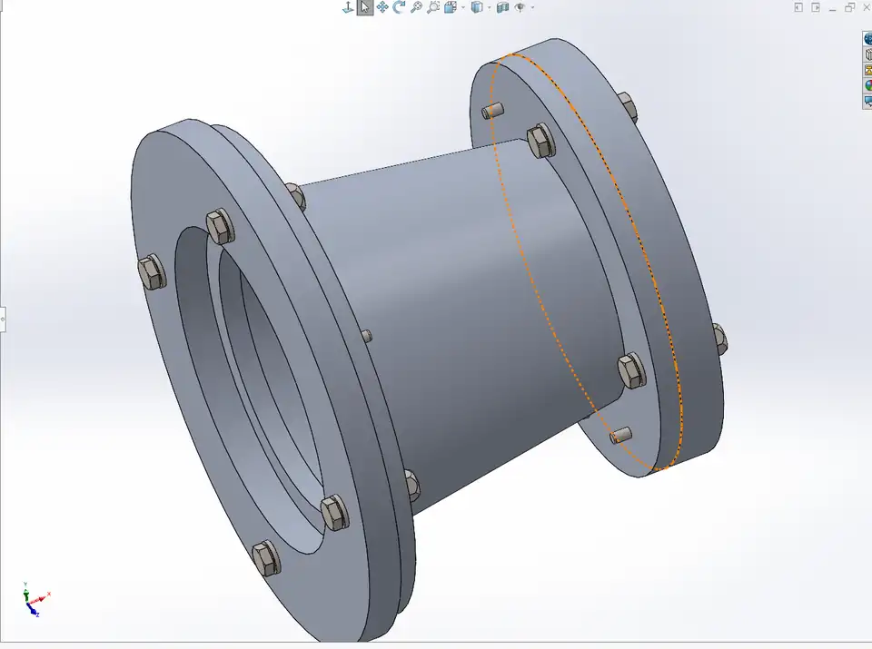
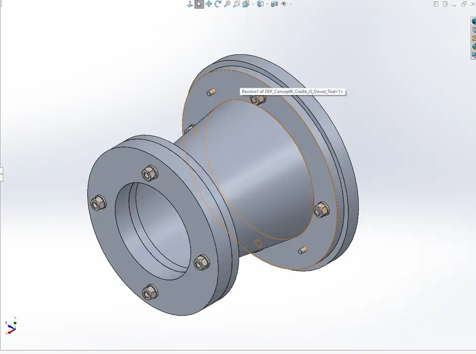
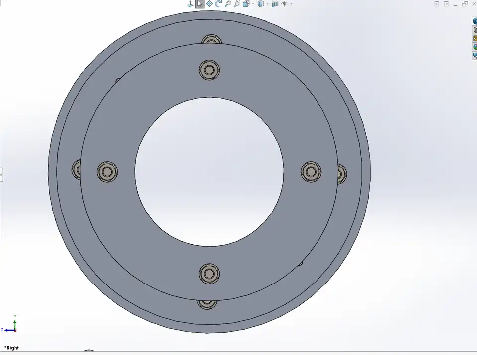
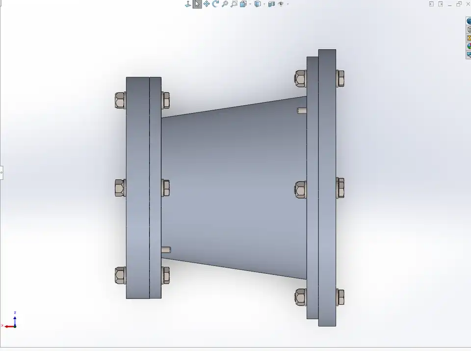

# Concept B J3 — original SolidWorks CAD gallery

**Images published and linked · Study Rev A (In Work) · Physical hardware release: HOLD**

These four images are the author's **actual SolidWorks screenshots** of `DEP_ConceptB_J3_Fastener_Integration_Rev00.SLDASM`, uploaded on 13 November 2026. They are not CAD reconstructions or generated illustrations. Select an image for its original full-resolution PNG.

## Side view

The tapered cradle's external profile and the two dissimilar flange diameters are visible. Trial fasteners and dowel ends are shown. **[Full-resolution PNG](j3_side_actual_2026-11-13.png)**

## End view

Circular interface arrangement with central opening, trial bolt positions and rear flange visible. **[Full-resolution PNG](j3_end_actual_2026-11-13.png)**

## Front isometric view

The solid tapered load path, interfaces and trial fasteners can be inspected together. **[Full-resolution PNG](j3_isometric_front_actual_2026-11-13.png)**

## Rear isometric view

A complementary view of the same saved J3 assembly. **[Full-resolution PNG](j3_isometric_rear_actual_2026-11-13.png)**

## Engineering interpretation and limitations

The images show assembly geometry, not completed hardware qualification. The M6 hardware is a trial/nominal installation: final bolt length/grip, fastener seating, torque/preload, thread engagement, contact distribution, dowel fit and clearance are unresolved. Earlier interference detection recorded nonzero collision volumes; mating constraints do **not** demonstrate that all parts can be manufactured or assembled as illustrated.

- [CAD and fastener engineering audit](../../docs/04_cad_review.md)
- [Open engineering risks and HOLD decision](../../docs/06_open_risks.md)
- [Original-image file inventory and SHA-256 register](IMAGE_PROVENANCE.md)
- [Engineering project walkthrough](../../docs/09_engineering_walkthrough.md)

The images are archived unchanged at 1920 × 1200, with smaller viewport-crop WebP previews for browsing. The native commercial Toolbox-derived CAD archive has not been released publicly. This is an independent educational portfolio design, not NASA-supplied or flight-qualified hardware.
