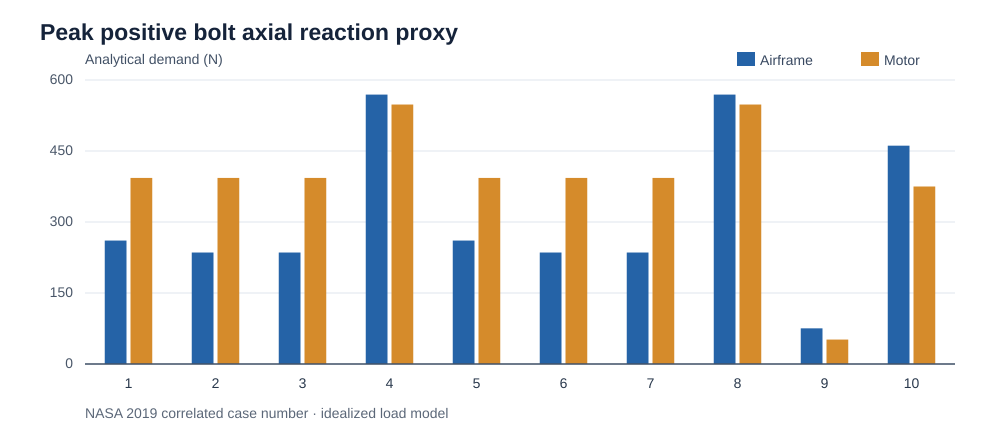
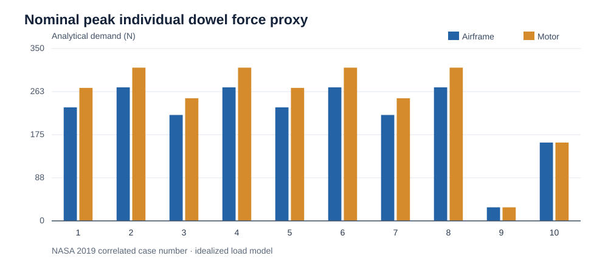

# 02 — Load-case sources and analytical fastener demand

## Source separation is intentional

The project used a **2019 NASA X-57 motor-reference source** for ten correlated Figure 13 loading scenarios, and a separate **2024 NASA Table 9** source for isolated load-group sensitivity checks. Their load bases differ and must **not be combined or interpreted as one approved flight-load envelope**.

### 2019 correlated combined-load model

All ten recorded cases were evaluated over assumed motor/propeller positions and both interfaces. Total evaluated interface/position cases: **180**. This is a model-specific sampling scheme; it does not imply 180 flight-load cases validated against an aircraft.

| Case | Airframe max positive bolt (N) | Motor max positive bolt (N) | Airframe max nominal single dowel (N) | Motor max nominal single dowel (N) |
|---:|---:|---:|---:|---:|
| 1 | 260.79 | 393.12 | 230.57 | 270.09 |
| 2 | 235.52 | 393.12 | 271.22 | 311.21 |
| 3 | 235.52 | 393.12 | 215.10 | 249.02 |
| 4 | **569.17** | **548.17** | 271.22 | 311.21 |
| 5 | 260.79 | 393.12 | 230.57 | 270.09 |
| 6 | 235.52 | 393.12 | 271.22 | 311.21 |
| 7 | 235.52 | 393.12 | 215.10 | 249.02 |
| 8 | **569.17** | **548.17** | 271.22 | 311.21 |
| 9 | 75.34 | 51.63 | 27.56 | 27.56 |
| 10 | 461.25 | 375.00 | 159.10 | 159.10 |

**Load-model interpretation:** Rigid-group analytical bolt/dowel reactions under assumed coordinate mapping and geometric application points. These are **not** bolt clamp force, thread stripping capacity, preloaded joint separation margin or measured pin force.

**Independent graph construction:** The two SVG figures above are redrawn from the recorded case-by-case results table, not passed off as exports from the original Colab notebook.

### Governing specific scenarios

- **Case 4** / equivalent case 8: idealized peak positive bolt reaction **569.17 N airframe**, **548.17 N motor**, with one recorded governing geometry at propeller x=270 mm and motor CG x=190 mm.
- **Case 2** / equivalent cases 4, 6 and 8 for the evaluated nominal pin force: peak **311.21 N motor** and **271.22 N airframe** with the recorded governing position at propeller x=170 mm, motor CG x=130 mm.

### Other stage-dependent calculations

The earlier 7M-11 isolated group screen found different governing reactions, such as **461.23 N airframe** for ground handling. The earlier 7M-6/7M-9 scenario basis also used ±119 N transverse loads and 29/44 N·m applied moments, but was **not an exact correlated published Figure 13 case**. Neither result should overwrite the final source-correlated study.

### Pin stress proxy and proof-load scenario

Under Phase 7M-13's nominal analytical load model:

| Interface | Peak nominal pin force (N) | Combined stress proxy (MPa) | Radial redistribution stress sensitivity (MPa) |
|---|---:|---:|---:|
| Motor | 311.210 | 154.659 | 220.623 |
| Airframe | 271.217 | 134.784 | 192.515 |

An illustrative **M6 class 8.8 proof comparison** placed the assumed peak bolt scenario at ~38% of the 11.6 kN reference proof load. This does **not** qualify the physical bolted connection: the preload and combined joint mechanics are assumptions, not installation evidence.

### Unresolved source-to-system mapping

Actual aircraft axes, installation location, all external equipment mass/CG, operating temperature, full inertia, sign correlation, fatigue cycles and representative load transfer through the airframe remain **OPEN**. No actual-airframe loads are certified by this study.
